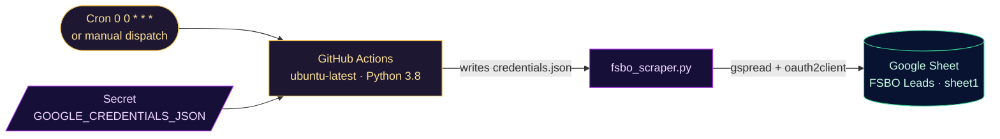

<p align="center">
  
</p>

<p align="center">
  
</p>

<p align="center">
  
  
  
  
</p>

**FSBO Leads Bot** is the skeleton of a for-sale-by-owner (FSBO) lead pipeline. A GitHub Actions workflow runs a Python script once a day. The script signs in to Google Sheets with a service account and appends rows to a spreadsheet called **FSBO Leads**. The sheet plumbing and the schedule work today. The script only writes a single hard-coded test row, because no listing source is scraped yet.

<p align="center"><sub><code>FSBO</code> ✦ <code>LEAD PIPELINE</code> ✦ <code>GITHUB ACTIONS</code> ✦ <code>GOOGLE SHEETS</code> ✦ <code>EARLY STAGE</code></sub></p>

<h2 align="center">✦ HOW IT RUNS ✦</h2>
<p align="center"><sub>ONE WORKFLOW, ONE SCRIPT, ONE SHEET</sub></p>



<table>
  <tr>
    <td width="33%" valign="top">⏰ <b>Daily schedule</b><br><sub><code>cron: '0 0 * * *'</code> runs at midnight UTC. <code>workflow_dispatch</code> lets you run it by hand.</sub></td>
    <td width="33%" valign="top">🔐 <b>Secret-based auth</b><br><sub>The service-account key lives in a repository secret and is written to <code>credentials.json</code> at run time. It is never committed.</sub></td>
    <td width="33%" valign="top">📊 <b>Sheet output</b><br><sub>Rows go to the first worksheet of the spreadsheet titled <code>FSBO Leads</code> (street, city, state, phone, email).</sub></td>
  </tr>
</table>

<p align="center">
  
</p>

<h2 align="center">◈ SETUP ◈</h2>
<p align="center"><sub>GOOGLE SHEETS + GITHUB SECRET</sub></p>

1. In Google Cloud, create a service account with the Google Sheets and Drive APIs enabled, then download its JSON key.
2. Create a Google Sheet named exactly **FSBO Leads** and share it with the service account's email as an editor.
3. Add the full JSON key as a repository secret named `GOOGLE_CREDENTIALS_JSON`.
4. Run **Automate FSBO Scraper** from the Actions tab, or wait for the nightly run.

| Name | Where | Purpose |
|---|---|---|
| `GOOGLE_CREDENTIALS_JSON` | GitHub Actions secret | Service-account key, written to `credentials.json` during the run |
| `credentials.json` | Local file (do not commit) | Key file read by `fsbo_scraper.py` |

<details>
<summary><b>Run it locally</b></summary>

<br>

```bash
git clone https://github.com/kamikaze1120/FSBO-leads-bot.git
cd FSBO-leads-bot
pip install gspread oauth2client pandas
# put your service-account key next to the script as credentials.json
python fsbo_scraper.py
```

</details>

<h2 align="center">◆ STATUS ◆</h2>
<p align="center"><sub>WHERE THE PROJECT STANDS</sub></p>

- **Working:** the scheduled workflow, the service-account login, and appending a row to the sheet.
- **Not implemented:** fetching real listings. The workflow installs `requests` and `beautifulsoup4` for this, but the current script doesn't use them. An earlier notebook prototype, since removed from the repo, sketched Zillow FSBO and Craigslist real-estate pages with de-duplication by listing URL.
- **Heads-up:** GitHub turns off scheduled workflows in repos with no recent activity. If the nightly run has stopped, re-enable it from the Actions tab.

<h2 align="center">✦ RESPONSIBLE USE ✦</h2>
<p align="center"><sub>BEFORE YOU POINT THIS AT A REAL SITE</sub></p>

> [!IMPORTANT]
> - Read and follow each site's **terms of service** and **`robots.txt`**. Many listing sites forbid automated scraping.
> - Keep request rates low, identify your client honestly, and back off on errors.
> - Seller contact details are personal data. Store them privately (never in a public repo or a public sheet) and delete what you don't need.
> - Follow the laws on contacting leads where you and they live, such as do-not-call registries, telemarketing and anti-spam rules, and real-estate licensing rules.

<br>

<p align="center">
  <sub><code>◉ FSBO LEADS BOT // GILDED ORBIT</code></sub><br>
  <sub>Made by <a href="https://github.com/kamikaze1120">kamikaze1120</a></sub>
</p>
